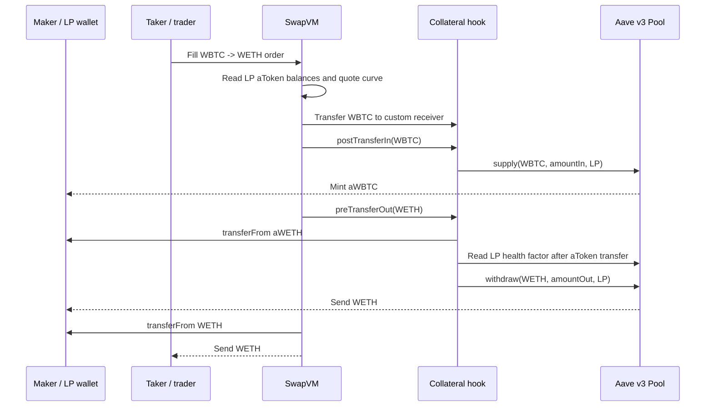

# Aave v3 Smart Position POC

## Purpose

This proof of concept tests whether a user can keep an Aave v3 position in
their own wallet while exposing that position as SwapVM AMM liquidity.

The user is the **maker / LP**. They hold their aTokens and debt position
directly in Aave. A **taker / trader** interacts only with the two underlying
ERC-20 assets (for example WETH and WBTC); the Aave supply, withdrawal, repay,
and borrow operations happen below the swap interface.

This is a design and integration POC, not production-ready code.

## Components

| Component | Role |
| --- | --- |
| `AaveV3CollateralHook` | Settles a Smart Collateral trade by supplying the input asset and redeeming the output asset. |
| `AaveV3XYCSwap` | Custom SwapVM instruction (`0x52`) which uses the maker's live aToken balances as constant-product reserves. |
| `AaveV3XYCSwapVMRouter` | POC router that dispatches the custom instruction. The standard router is unchanged. |
| `AaveV3SmartDebtHook` | Settles a Smart Debt trade by repaying input debt and borrowing output debt. |
| `IAaveV3Pool` | Minimal Aave Pool interface used by the POC. |

## Smart Collateral AMM

The maker provides two Aave-supplied assets as AMM reserves. For example, a
maker has aWETH and aWBTC, while traders swap real WETH and WBTC.

The curve reads balances at execution time:

```text
reserveA = aTokenA.balanceOf(maker)
reserveB = aTokenB.balanceOf(maker)
```

For an exact-input fill, it uses the constant-product formula:

```text
amountOut = amountIn * reserveOut / (reserveIn + amountIn)
```

This means Aave supply interest is included automatically: if an aToken balance
increases, the next quote sees the larger reserve. The POC supports exact-output
quoting as well, with maker-favouring ceiling rounding and a rejection when the
requested output reaches the full reserve.

### Fill sequence



The user therefore ends with less aWETH and more aWBTC. The trader never holds
or needs to understand aTokens.

### Health-factor invariant

After the hook pulls the output aTokens from the maker (which removes that
collateral from the maker's Aave account), it reads
`Pool.getUserAccountData(maker)` and requires:

```text
healthFactor >= 1.5e18
```

The check is inclusive: a fill at exactly 1.5 succeeds; a fill below it reverts.
Because the whole transaction is atomic, an unsuccessful check restores the
taker input, the maker aTokens, and the Aave position changes.

The hook also requires Aave's returned withdrawal amount to equal the quoted
output amount. A short withdrawal reverts rather than leaving the settlement
partially completed.

## Smart Debt POC

Smart Debt changes the composition of a maker's liabilities rather than their
collateral. A taker's input asset repays the maker's debt; the hook borrows the
output asset on the maker's behalf, then SwapVM delivers it to the taker.

```text
taker pays USDC
  -> hook repays maker USDC debt
  -> hook borrows WETH on behalf of maker
  -> trader receives WETH
```

The debt hook applies the same post-borrow `HF >= 1.5` check. It also uses
strict repayment: Aave's returned `repaid` amount must equal `amountIn`.
Therefore a fill whose input exceeds the maker's remaining debt reverts rather
than leaving surplus taker funds in the hook.

The POC does not yet define a live-reserve debt AMM instruction. The collateral
curve must not be reused blindly for debt, because the economic state and risk
constraints are different.

## Authorization model

### LP / maker permissions

For Smart Collateral, the LP approves the collateral hook to spend the relevant
aTokens. This is an intentionally standing approval so an AMM order can fill
many times. A normal ERC-20 `approve` is the selected POC UX; permits are not
used.

The approval alone does not let a trader take aTokens:

1. The hook accepts settlement callbacks only from its configured SwapVM.
2. SwapVM verifies the maker's signature before any transfers or hook calls.
3. The signature commits to the order, including the pair, receiver, hook
   configuration, and curve program.

Anyone may fill a valid public AMM order. That is expected; they can consume
the approval only by paying the curve-quoted input. They cannot fabricate an
order for an LP without the LP's signature.

For Smart Debt, a real Aave deployment additionally requires the LP to grant
the hook **variable-debt credit delegation** for each output debt asset. The
mock pool omits this enforcement, but real Aave rejects `borrow(..., maker)` if
the hook lacks sufficient delegation.

### Trader / taker permissions

The trader approves SwapVM for the underlying asset they pay. They need no
aToken approval, Aave account, or credit delegation.

## Tests

The deterministic Solidity tests cover:

- normal zero-debt Smart Collateral settlement;
- live aToken-reserve XYK quoting and accrued aToken interest;
- post-trade health factor, including the exact `1.5` boundary and a fill below
  it;
- Aave oracle/risk changes occurring after order creation but before fill;
- short withdrawal / insufficient liquidity handling;
- strict partial-repayment handling for Smart Debt;
- direct-hook and forged-maker-authorization attempts;
- Smart Debt health-factor rejection.

Run the local set with:

```bash
corepack yarn test test/AaveV3CollateralHook.t.sol test/AaveV3XYCSwap.t.sol test/AaveV3SmartDebtHook.t.sol
```

An opt-in mainnet fork test uses the real Ethereum Aave v3 Pool, WETH, USDC,
aWETH, and aUSDC at block `22,000,000`. It performs an actual collateral fill
and asserts the resulting real Aave health factor is at least 1.5. See
[`aave-v3-fork-tests.md`](aave-v3-fork-tests.md) for the RPC setup. Without
`MAINNET_RPC_URL`, that test deliberately becomes a no-op.

## Explicit POC limitations

- The custom router exceeds the EVM mainnet contract-size limit; an MVP needs a
  deployable extension architecture.
- No complete LP lifecycle exists yet: deposit configuration, changing curves,
  pausing, withdrawal, allowance management, and user UX are out of scope.
- The live curve has no external price/oracle protection, fees, or liquidity
  limits. It can be economically arbitraged.
- Aave reserve configuration, eMode, isolation mode, caps, pool liquidity, and
  credit delegation need full production integration and fork coverage.
- The mock Aave pool is only a controllable test double; it is not a model of
  every Aave accounting or validation rule.
- No audit, formal invariant suite, or production security review has been
  performed.
